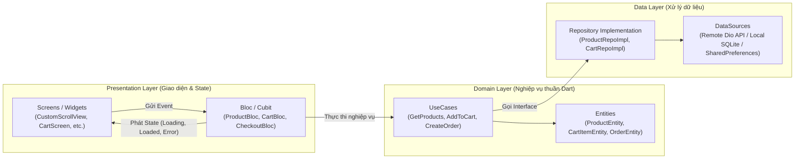
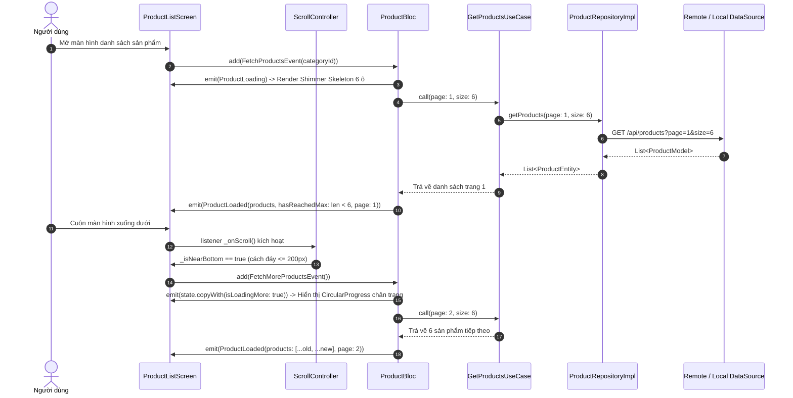
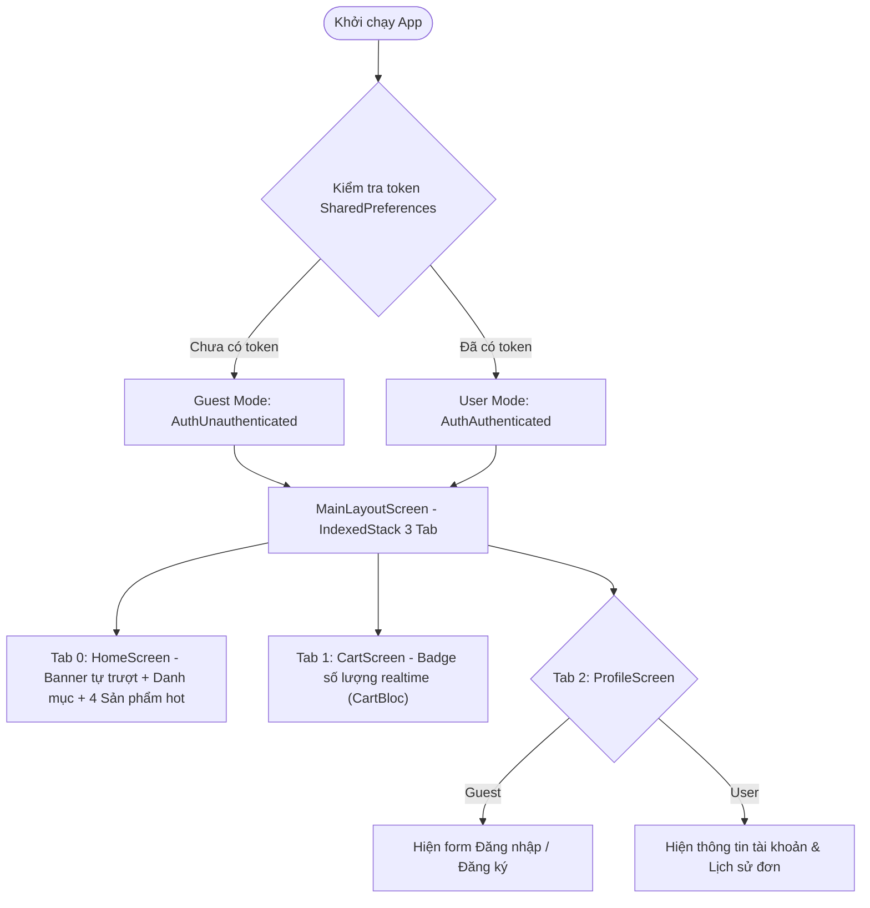
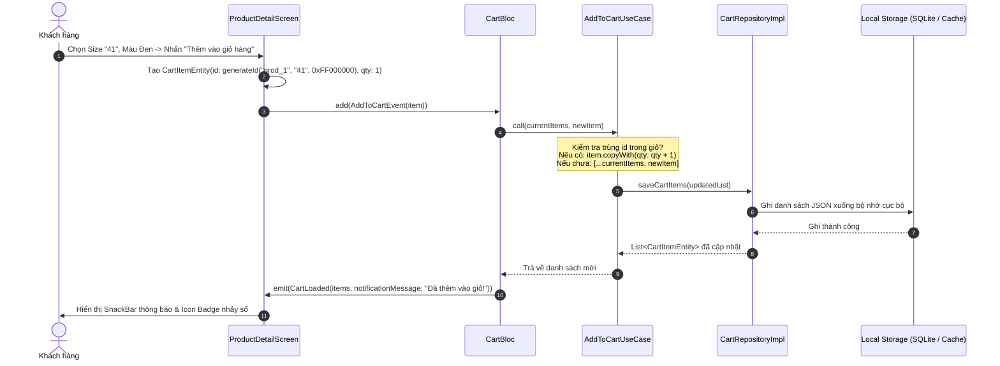
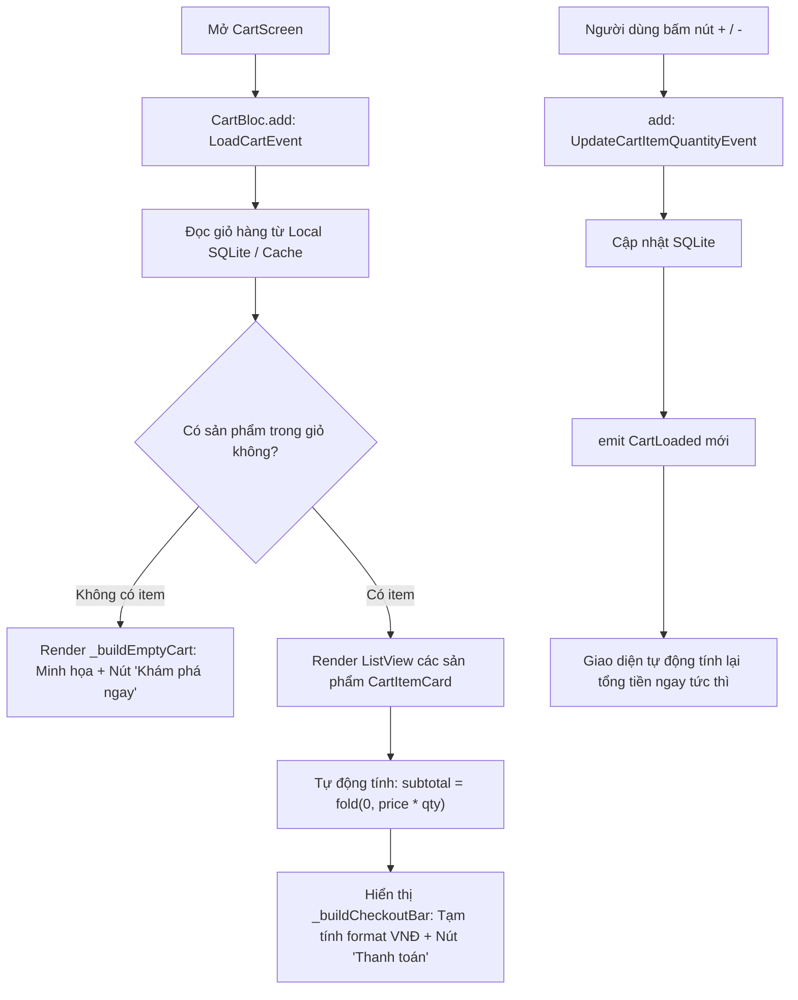
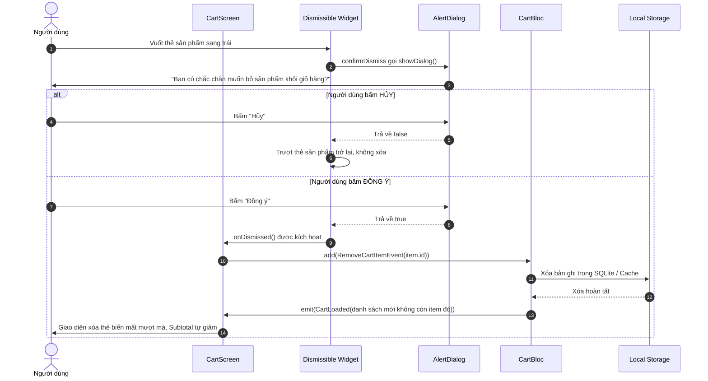
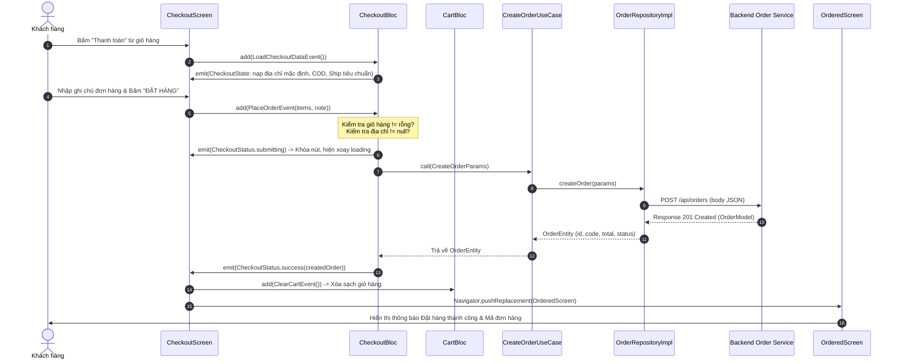

# BÁO CÁO CÂU 3: CHỨNG MINH HIỂU CODE VÀ WORKFLOW HỆ THỐNG
**Học phần:** Phát triển ứng dụng di động (Flutter)  
**Dự án:** `sports-store-mobile` (Cửa hàng thời trang & đồ thể thao đa thương hiệu)  
**Sinh viên thực hiện:** Thái San Yo  
**Mã số sinh viên:** CE190435  
**Vai trò:** Domain Owner — Phụ trách Home Layout, Product Catalog, Shopping Cart & Order Checkout  
**Danh sách Use Cases đảm nhận (6 UCs):**
1. **UC-04:** View product list (Xem danh sách sản phẩm, Grid 2 cột & Infinite Scroll)
2. **UC-07:** Home layout (Khung điều hướng `MainLayoutScreen`, `HomeScreen` & Lazy Login)
3. **UC-11:** Add product to cart (Thêm sản phẩm vào giỏ, gộp biến thể Size/Màu)
4. **UC-12:** View shopping cart (Xem giỏ hàng, cập nhật số lượng, tính tổng tiền VNĐ)
5. **UC-13:** Remove item from cart (Xóa sản phẩm bằng vuốt Dismissible, Dialog xác nhận, Xóa hết)
6. **UC-08:** Order items (Quy trình Checkout, chọn địa chỉ, phương thức COD, tạo đơn hàng)

---

## TỔNG QUAN KIẾN TRÚC ÁP DỤNG TRONG CODE
Mọi tính năng tôi đảm nhận đều tuân thủ nghiêm ngặt **Feature-First Clean Architecture** kết hợp mẫu quản lý trạng thái **BLoC (Business Logic Component)**:



---

## 1. USE CASE UC-04: VIEW PRODUCT LIST (XEM DANH SÁCH SẢN PHẨM & PHÂN TRANG VÔ TẬN)

### 1.1. Bài toán & Quy luật nghiệp vụ (Business Rules)
- **Mục đích:** Cung cấp cho khách hàng danh sách sản phẩm dạng lưới 2 cột đối xứng (chuẩn giao diện thời trang thể thao Adidas), hỗ trợ tải dữ liệu theo từng trang (Pagination 6 sản phẩm/trang) khi cuộn màn hình (Infinite Scroll) và kéo để làm mới (Pull-to-Refresh).
- **Quy luật thực thi:**
  1. Khi mở màn hình, phát `FetchProductsEvent(page: 1)` để hiển thị 6 ô khung xương Skeleton Shimmer.
  2. Khi người dùng cuộn danh sách đến vị trí **cách đáy 200px** (`currentScroll >= maxScroll - 200`), hệ thống tự động kích hoạt `FetchMoreProductsEvent()`.
  3. **Cơ chế phòng thủ (Guard Clause):**
     - Nếu đang tải thêm (`isLoadingMore == true`), chặn không gửi thêm request trùng lặp.
     - Nếu đã hết sản phẩm trên server (`hasReachedMax == true` khi số lượng trả về `< pageSize`), dừng phân trang.
  4. Hỗ trợ lọc đồng bộ theo `categoryId` khi người dùng chuyển từ màn hình Danh mục qua.

### 1.2. Sơ đồ Workflow thực thi (BLoC Sequence Diagram)



### 1.3. Giải thích các đoạn code chính & Mục đích từng dòng

#### A. File BLoC: [product_bloc.dart](file:///d:/New%20folder/mobile/lib/features/product/presentation/bloc/product_bloc.dart)
```dart
class ProductBloc extends Bloc<ProductEvent, ProductState> {
  final GetProductsUseCase getProductsUseCase;
  static const int pageSize = 6; // Kích thước phân trang 6 items/trang

  ProductBloc({required this.getProductsUseCase}) : super(const ProductInitial()) {
    on<FetchProductsEvent>(_onFetchProducts);
    on<FetchMoreProductsEvent>(_onFetchMoreProducts);
  }

  // Xử lý lấy trang 1 hoặc Pull-to-Refresh
  Future<void> _onFetchProducts(FetchProductsEvent event, Emitter<ProductState> emit) async {
    emit(const ProductLoading()); // 1. Báo UI render Skeleton
    try {
      final products = await getProductsUseCase(
        page: 1,
        size: pageSize,
        categoryId: event.categoryId,
        keyword: event.keyword,
      );
      // 2. Nếu trả về ít hơn pageSize (ví dụ 4 < 6) thì hasReachedMax = true
      emit(ProductLoaded(
        products: products,
        hasReachedMax: products.length < pageSize,
        currentPage: 1,
      ));
    } catch (e) {
      emit(ProductError(message: 'Không thể tải danh sách sản phẩm. Vui lòng thử lại sau.'));
    }
  }

  // Xử lý Infinite Scroll tải thêm sản phẩm khi cuộn
  Future<void> _onFetchMoreProducts(FetchMoreProductsEvent event, Emitter<ProductState> emit) async {
    final currentState = state;
    // Guard 1: Phải ở state ProductLoaded mới tải tiếp
    if (currentState is! ProductLoaded) return;
    // Guard 2: Nếu đã chạm đáy dữ liệu hoặc đang trong một request tải dở thì bỏ qua ngay lập tức
    if (currentState.hasReachedMax || currentState.isLoadingMore) return;

    // Bật cờ isLoadingMore để UI hiện thanh tiến trình nhỏ ở cuối
    emit(currentState.copyWith(isLoadingMore: true));

    try {
      final nextPage = currentState.currentPage + 1;
      final moreProducts = await getProductsUseCase(page: nextPage, size: pageSize);

      if (moreProducts.isEmpty) {
        emit(currentState.copyWith(hasReachedMax: true, isLoadingMore: false));
      } else {
        // Nối mảng: kết hợp sản phẩm cũ và sản phẩm mới
        emit(ProductLoaded(
          products: [...currentState.products, ...moreProducts],
          hasReachedMax: moreProducts.length < pageSize,
          isLoadingMore: false,
          currentPage: nextPage,
        ));
      }
    } catch (e) {
      emit(currentState.copyWith(isLoadingMore: false));
    }
  }
}
```

#### B. File Màn hình: [product_list_screen.dart](file:///d:/New%20folder/mobile/lib/features/product/presentation/screens/product_list_screen.dart)
```dart
  @override
  void initState() {
    super.initState();
    // Bắn event khởi tạo nạp dữ liệu
    context.read<ProductBloc>().add(FetchProductsEvent(categoryId: widget.categoryId));
    // Đăng ký listener cho thanh cuộn
    _scrollController.addListener(_onScroll);
  }

  void _onScroll() {
    // Kiểm tra ngưỡng cuộn
    if (_isNearBottom) {
      context.read<ProductBloc>().add(const FetchMoreProductsEvent());
    }
  }

  bool get _isNearBottom {
    if (!_scrollController.hasClients) return false;
    final maxScroll = _scrollController.position.maxScrollExtent; // Chiều dài tối đa có thể cuộn
    final currentScroll = _scrollController.offset;              // Vị trí cuộn hiện tại
    return currentScroll >= (maxScroll - 200);                  // Còn 200px nữa là chạm đáy
  }
```

---

## 2. USE CASE UC-07: HOME LAYOUT (KHUNG ĐIỀU HƯỚNG SHELL & TRANG CHỦ LAZY LOGIN)

### 2.1. Bài toán & Quy luật nghiệp vụ (Business Rules)
- **Mục đích:** Xây dựng bố cục chính của app với thanh Bottom Navigation 3 tab: `Trang chủ`, `Giỏ hàng` (kèm Badge hiển thị số lượng theo thời gian thực), `Tài khoản`.
- **Cơ chế Lazy Login (Đăng nhập lười):** Khách vãng lai chưa đăng nhập vẫn được trải nghiệm xem hàng, lướt trang chủ, tìm kiếm tự do. Khi chuyển sang tab Profile hoặc bấm Mua hàng, hệ thống mới kiểm tra xác thực.
- **Tối ưu hiệu năng:** Dùng `IndexedStack` để giữ nguyên trạng thái render và vị trí cuộn của cả 3 tab, tránh việc chuyển tab gây reload lại dữ liệu từ đầu.
- **Auto-scroll Marketing Banner:** Sử dụng `PageView.builder` kết hợp `Timer.periodic(Duration(seconds: 4))` để tự động trượt banner quảng cáo.

### 2.2. Sơ đồ Workflow thực thi



### 2.3. Giải thích các đoạn code chính & Mục đích từng dòng

#### A. File Điều hướng: [main_layout_screen.dart](file:///d:/New%20folder/mobile/lib/features/home/presentation/screens/main_layout_screen.dart)
```dart
  int _currentIndex = 0; // Biến state lưu vị trí tab hiện tại

  @override
  Widget build(BuildContext context) {
    final screens = [
      const HomeScreen(),
      CartScreen(onExploreTap: () => _onTabTapped(0)), // Nhấn Khám phá từ giỏ hàng sẽ chuyển về tab 0
      const ProfileScreen(),
    ];

    return Scaffold(
      // IndexedStack: Giúp giữ nguyên vị trí scroll của từng tab trong bộ nhớ RAM
      body: IndexedStack(index: _currentIndex, children: screens),
      bottomNavigationBar: Container(
        // Lắng nghe CartBloc để lấy tổng số lượng món đồ hiển thị lên icon Badge
        child: BlocBuilder<CartBloc, CartState>(
          builder: (context, cartState) {
            final cartCount = cartState is CartLoaded ? cartState.totalQuantity : 0;

            return BottomNavigationBar(
              currentIndex: _currentIndex,
              onTap: _onTabTapped,
              items: [
                const BottomNavigationBarItem(
                  icon: Icon(Icons.home_outlined),
                  label: 'Trang chủ',
                ),
                BottomNavigationBarItem(
                  // Badge động: Chỉ hiển thị chấm đỏ và con số khi cartCount > 0
                  icon: Badge(
                    isLabelVisible: cartCount > 0,
                    label: Text('$cartCount'),
                    backgroundColor: AppColors.primary,
                    child: const Icon(Icons.shopping_bag_outlined),
                  ),
                  label: 'Giỏ hàng',
                ),
                const BottomNavigationBarItem(
                  icon: Icon(Icons.person_outline_rounded),
                  label: 'Tài khoản',
                ),
              ],
            );
          },
        ),
      ),
    );
  }
```

#### B. File Trang chủ: [home_screen.dart](file:///d:/New%20folder/mobile/lib/features/home/presentation/screens/home_screen.dart)
```dart
  @override
  void initState() {
    super.initState();
    // Kích hoạt nạp sản phẩm ban đầu nếu BLoC đang ở trạng thái rỗng
    final productBloc = context.read<ProductBloc>();
    if (productBloc.state is ProductInitial) {
      productBloc.add(const FetchProductsEvent());
    }

    // Thiết lập Timer tự động chạy banner xoay vòng mỗi 4 giây
    _bannerTimer = Timer.periodic(const Duration(seconds: 4), (timer) {
      if (_bannerController.hasClients) {
        final nextIndex = (_currentBannerIndex + 1) % _banners.length;
        _bannerController.animateToPage(
          nextIndex,
          duration: const Duration(milliseconds: 600),
          curve: Curves.easeInOutCubic,
        );
      }
    });
  }

  @override
  void dispose() {
    // Hủy Timer khi thoát màn hình để ngăn ngừa rò rỉ tài nguyên (Memory Leak)
    _bannerTimer?.cancel();
    _bannerController.dispose();
    super.dispose();
  }
```

---

## 3. USE CASE UC-11: ADD PRODUCT TO CART (THÊM SẢN PHẨM VÀO GIỎ HÀNG)

### 3.1. Bài toán & Quy luật nghiệp vụ (Business Rules)
- **Mục đích:** Cho phép khách hàng thêm một sản phẩm đã chọn đầy đủ Kích cỡ (Size) và Màu sắc (Color) vào giỏ hàng cá nhân từ màn hình chi tiết sản phẩm.
- **Quy luật phân biệt biến thể (Composite Key):**
  - Khóa định danh của mỗi item trong giỏ: `id = generateId(productId, size, color)` (VD: `"p1_41_4282664004"`).
  - **Trường hợp trùng biến thể:** Nếu sản phẩm có cùng ID, cùng Size và cùng Mã màu đã tồn tại trong giỏ hàng, hệ thống **không tạo dòng mới** mà thực hiện cộng dồn số lượng: `item.quantity += newItem.quantity`.
  - **Trường hợp biến thể mới:** Nối thêm một thực thể `CartItemEntity` mới vào danh sách giỏ hàng.
- **Đồng bộ dữ liệu:** Ngay sau khi thêm vào danh sách, danh sách giỏ hàng được serialize và lưu xuống Local Storage (`SharedPreferences` / SQLite) để duy trì khi tắt app.
- **Phản hồi giao diện:** Phát `CartLoaded` kèm thông báo chuỗi `notificationMessage` để UI kích hoạt `SnackBar` thông báo thành công kèm nút "Đi đến giỏ hàng".

### 3.2. Sơ đồ Workflow thực thi



### 3.3. Giải thích các đoạn code chính & Mục đích từng dòng

#### A. File Entity: [cart_item_entity.dart](file:///d:/New%20folder/mobile/lib/features/cart/domain/entities/cart_item_entity.dart)
```dart
  /// Tạo ID duy nhất cho biến thể trong giỏ: productId_size_color
  /// Giải quyết bài toán: Cùng 1 đôi giày nhưng mua size 40 và size 41 là 2 món khác nhau
  static String generateId(String productId, String size, int color) {
    return '${productId}_${size}_$color';
  }

  /// Thuộc tính tính toán: Thành tiền của từng món = Đơn giá * Số lượng
  double get totalPrice => price * quantity;
```

#### B. File BLoC: [cart_bloc.dart](file:///d:/New%20folder/mobile/lib/features/cart/presentation/bloc/cart_bloc.dart)
```dart
  Future<void> _onAddToCart(
    AddToCartEvent event,
    Emitter<CartState> emit,
  ) async {
    // 1. Trích xuất danh sách các item đang có trong giỏ
    final currentItems =
        state is CartLoaded ? (state as CartLoaded).items : <CartItemEntity>[];
    try {
      // 2. Gọi UseCase thực thi kiểm tra trùng và cập nhật
      final updatedList = await addToCartUseCase(
        currentItems: currentItems,
        newItem: event.item,
      );
      // 3. Emit CartLoaded kèm thông báo để SnackBar hiển thị trên UI
      emit(CartLoaded(
        items: updatedList,
        lastAddedItem: event.item,
        notificationMessage: 'Đã thêm ${event.item.name} vào giỏ hàng!',
      ));
    } catch (e) {
      emit(CartError('Không thể thêm vào giỏ hàng: ${e.toString()}'));
    }
  }
```

---

## 4. USE CASE UC-12: VIEW SHOPPING CART (XEM GIỎ HÀNG & TÍNH TỔNG TIỀN)

### 4.1. Bài toán & Quy luật nghiệp vụ (Business Rules)
- **Mục đích:** Hiển thị danh sách đầy đủ các sản phẩm đã chọn mua, kèm hình ảnh, tên, biến thể size/màu, đơn giá, bộ tăng giảm số lượng (+ / -) và thanh Sticky Checkout Bar dính ở chân màn hình.
- **Quy luật tính toán tiền tệ:**
  - `Subtotal (Tạm tính) = Tổng xích ma (item.price * item.quantity)` của tất cả món đồ trong giỏ.
  - Định dạng hiển thị bắt buộc chuẩn **Việt Nam Đồng (VNĐ)** qua `CurrencyFormatter.formatVnd()`: phân cách hàng ngàn bằng dấu chấm (ví dụ: `3.900.000 ₫`).
- **Giới hạn số lượng (Validation):**
  - Bấm nút `-`: Số lượng giảm đi 1. Nếu số lượng đang là 1, nút `-` bị vô hiệu hóa hoặc bấm vào sẽ gợi ý xóa món khỏi giỏ.
  - Bấm nút `+`: Số lượng tăng thêm 1 (không vượt quá `stock` tồn kho).
- **Trạng thái giỏ hàng rỗng (Empty State):** Khi danh sách không có sản phẩm nào (`items.isEmpty`), hiển thị giao diện minh họa túi hàng trống kèm nút kêu gọi hành động "Khám phá ngay" đưa người dùng về Tab Trang chủ.

### 4.2. Sơ đồ Workflow thực thi



### 4.3. Giải thích các đoạn code chính & Mục đích từng dòng

#### A. File Giao diện: [cart_screen.dart](file:///d:/New%20folder/mobile/lib/features/cart/presentation/screens/cart_screen.dart)
```dart
  // Widget thanh toán dính ở chân màn hình (Sticky Bottom Bar)
  Widget _buildCheckoutBar(BuildContext context, CartLoaded state) {
    return Container(
      padding: const EdgeInsets.symmetric(horizontal: 20, vertical: 16),
      decoration: BoxDecoration(
        color: Colors.white,
        borderRadius: const BorderRadius.vertical(top: Radius.circular(20)),
        boxShadow: [
          BoxShadow(
            color: Colors.black.withValues(alpha: 0.06),
            blurRadius: 10,
            offset: const Offset(0, -4),
          ),
        ],
      ),
      child: SafeArea(
        child: Row(
          children: [
            Column(
              crossAxisAlignment: CrossAxisAlignment.start,
              mainAxisSize: MainAxisSize.min,
              children: [
                // Hiển thị tổng số lượng món đồ
                Text(
                  'Tạm tính (${state.totalQuantity} món):',
                  style: TextStyle(fontSize: 13, color: Colors.grey.shade600),
                ),
                const SizedBox(height: 4),
                // Định dạng tiền tệ VNĐ (ví dụ: 1.950.000 ₫)
                Text(
                  CurrencyFormatter.formatVnd(state.subtotal),
                  style: const TextStyle(
                    fontSize: 18,
                    fontWeight: FontWeight.w800,
                    color: AppColors.primary,
                  ),
                ),
              ],
            ),
            const Spacer(),
            // Nút bấm mở màn hình CheckoutScreen
            ElevatedButton(
              onPressed: () {
                Navigator.of(context).push(
                  CheckoutScreen.route(items: state.items),
                );
              },
              child: const Text('Thanh toán'),
            ),
          ],
        ),
      ),
    );
  }
```

---

## 5. USE CASE UC-13: REMOVE ITEM FROM CART (XÓA SẢN PHẨM KHỎI GIỎ HÀNG)

### 5.1. Bài toán & Quy luật nghiệp vụ (Business Rules)
- **Mục đích:** Cung cấp trải nghiệm xóa linh hoạt và an toàn:
  1. **Thao tác cử chỉ vuốt ngang (Swipe-to-delete):** Vuốt từ phải sang trái (`DismissDirection.endToStart`) để lộ nền đỏ và icon thùng rác.
  2. **Nút icon thùng rác trực tiếp:** Nằm trên từng thẻ sản phẩm `CartItemCard`.
  3. **Nút "Xóa tất cả" (`delete_sweep`):** Nằm trên AppBar giỏ hàng.
- **Cơ chế xác nhận an toàn (Dialog Confirmation):** Tránh việc người dùng vô tình chạm nhầm tay làm mất sản phẩm trong giỏ:
  - Bắt buộc kích hoạt hộp thoại `AlertDialog` hỏi: *"Bạn có chắc chắn muốn bỏ [Tên sản phẩm] khỏi giỏ hàng?"*.
  - Chỉ khi người dùng chọn **"Đồng ý"** (`Navigator.pop(dialogCtx, true)`), BLoC mới nhận `RemoveCartItemEvent`.
  - Nếu chọn **"Hủy"**, thao tác vuốt bị hủy và item trượt trở lại vị trí ban đầu.

### 5.2. Sơ đồ Workflow thực thi



### 5.3. Giải thích các đoạn code chính & Mục đích từng dòng

#### A. File Giao diện: [cart_screen.dart](file:///d:/New%20folder/mobile/lib/features/cart/presentation/screens/cart_screen.dart)
```dart
  return Dismissible(
    key: ValueKey(item.id),
    direction: DismissDirection.endToStart, // Vuốt từ phải sang trái
    // Giao diện nền đỏ hiển thị icon thùng rác và chữ "Xóa"
    background: Container(
      alignment: Alignment.centerRight,
      color: Colors.red.shade400,
      padding: const EdgeInsets.only(right: 20),
      child: const Row(
        mainAxisAlignment: MainAxisAlignment.end,
        children: [
          Icon(Icons.delete_outline, color: Colors.white, size: 28),
          SizedBox(width: 8),
          Text('Xóa', style: TextStyle(color: Colors.white, fontWeight: FontWeight.bold)),
        ],
      ),
    ),
    // Hộp thoại xác nhận trước khi xóa (trả về true/false)
    confirmDismiss: (direction) async {
      return await showDialog<bool>(
        context: context,
        builder: (dialogCtx) => AlertDialog(
          title: const Text('Bỏ sản phẩm'),
          content: Text('Bạn có chắc chắn muốn bỏ "${item.name}" khỏi giỏ hàng?'),
          actions: [
            TextButton(
              onPressed: () => Navigator.pop(dialogCtx, false), // Không xóa
              child: const Text('Hủy'),
            ),
            TextButton(
              style: TextButton.styleFrom(foregroundColor: Colors.red),
              onPressed: () => Navigator.pop(dialogCtx, true),  // Xác nhận xóa
              child: const Text('Đồng ý'),
            ),
          ],
        ),
      );
    },
    // Khi xác nhận true, bắn event vào CartBloc
    onDismissed: (direction) {
      context.read<CartBloc>().add(RemoveCartItemEvent(item.id));
    },
    child: CartItemCard(item: item, ...),
  );
```

#### B. File BLoC: [cart_bloc.dart](file:///d:/New%20folder/mobile/lib/features/cart/presentation/bloc/cart_bloc.dart)
```dart
  Future<void> _onRemoveItem(
    RemoveCartItemEvent event,
    Emitter<CartState> emit,
  ) async {
    final currentItems =
        state is CartLoaded ? (state as CartLoaded).items : <CartItemEntity>[];
    try {
      // Gọi UseCase lọc bỏ item có ID trùng khớp và lưu DB
      final updatedList = await removeFromCartUseCase(
        currentItems: currentItems,
        itemId: event.itemId,
      );
      // Phát state mới, UI re-render và tính lại tiền tự động
      emit(CartLoaded(items: updatedList));
    } catch (e) {
      emit(CartError('Không thể xóa sản phẩm khỏi giỏ hàng: ${e.toString()}'));
    }
  }
```

---

## 6. USE CASE UC-08: ORDER ITEMS (ĐẶT HÀNG & THANH TOÁN CHECKOUT)

### 6.1. Bài toán & Quy luật nghiệp vụ (Business Rules)
- **Mục đích:** Khách hàng tiến hành tạo đơn hàng từ các sản phẩm trong giỏ hàng tại `CheckoutScreen`.
- **Các bước quy trình nghiệp vụ (Checkout Workflow):**
  1. **Địa chỉ giao hàng (Shipping Address):** Tự động nạp địa chỉ mặc định của người dùng từ `GetAddressesUseCase`. Nếu chưa có, người dùng bấm chọn/thêm từ sổ địa chỉ hành chính 3 cấp VN (`AddressListScreen`). Bắt buộc phải có địa chỉ mới cho đặt hàng.
  2. **Phương thức thanh toán (Payment Method):** Hỗ trợ phương thức chính **COD (Thanh toán khi nhận hàng)** và tích hợp sẵn cấu trúc cho VNPAY/MoMo.
  3. **Phương thức vận chuyển (Shipping Method):** Giao hàng tiêu chuẩn (30.000 ₫) hoặc Giao hỏa tốc (50.000 ₫).
  4. **Áp dụng Voucher giảm giá (UC-22):** Tự động trừ tiền giảm giá vào tổng thanh toán.
  5. **Tính toán tổng đơn:**
     $$\text{Tổng thanh toán} = \text{Tạm tính (Subtotal)} + \text{Phí ship} - \text{Giảm giá Voucher}$$
  6. **Tạo đơn hàng:** Bấm nút "Đặt hàng", gọi `POST /api/orders` với payload chi tiết. Khi thành công, xóa sạch giỏ hàng (`ClearCartEvent`) và điều hướng sang màn hình thành công `OrderedScreen`.

### 6.2. Sơ đồ Workflow thực thi



### 6.3. Giải thích các đoạn code chính & Mục đích từng dòng

#### A. File BLoC: [checkout_bloc.dart](file:///d:/New%20folder/mobile/lib/features/order/presentation/bloc/checkout_bloc.dart)
```dart
  Future<void> _onPlaceOrder(
    PlaceOrderEvent event,
    Emitter<CheckoutState> emit,
  ) async {
    // 1. Kiểm tra validation: Giỏ hàng không được rỗng
    if (event.items.isEmpty) {
      emit(state.copyWith(
        status: CheckoutStatus.failure,
        errorMessage: 'Giỏ hàng trống, không thể đặt hàng.',
      ));
      return;
    }

    // 2. Kiểm tra validation: Bắt buộc phải có địa chỉ nhận hàng
    final shippingAddress = state.selectedAddress;
    if (shippingAddress == null) {
      emit(state.copyWith(
        status: CheckoutStatus.failure,
        errorMessage: 'Vui lòng chọn địa chỉ nhận hàng trước khi đặt hàng.',
      ));
      return;
    }

    // 3. Chuyển trạng thái submitting để UI khóa nút và hiện xoay loading
    emit(state.copyWith(status: CheckoutStatus.submitting, clearError: true));

    try {
      // 4. Map từ CartItem sang OrderItem
      final orderItems = event.items
          .map((cartItem) => OrderItemEntity.fromCartItem(cartItem))
          .toList();

      // 5. Tính tổng phụ Subtotal
      final subtotal = event.items.fold<double>(
        0.0,
        (sum, item) => sum + item.totalPrice,
      );

      // 6. Gọi UseCase tạo đơn hàng gửi payload chi tiết lên hệ thống
      final order = await createOrderUseCase(
        CreateOrderParams(
          items: orderItems,
          shippingAddress: shippingAddress,
          paymentMethod: state.paymentMethod,
          shippingMethod: state.shippingMethod,
          subtotal: subtotal,
          shippingFee: state.shippingMethod.fee,
          discountAmount: state.discountAmount,
          note: event.note?.trim().isEmpty == true ? null : event.note?.trim(),
        ),
      );

      // 7. Thành công: Phát state success kèm đơn hàng vừa được tạo
      emit(state.copyWith(
        status: CheckoutStatus.success,
        createdOrder: order,
        clearError: true,
      ));
    } catch (e) {
      // 8. Bắt lỗi ngoại lệ và báo lỗi thân thiện cho khách hàng
      emit(state.copyWith(
        status: CheckoutStatus.failure,
        errorMessage: 'Đặt hàng thất bại: ${e.toString()}',
      ));
    }
  }
```

#### B. File Màn hình: [checkout_screen.dart](file:///d:/New%20folder/mobile/lib/features/order/presentation/screens/checkout_screen.dart)
```dart
  // Xử lý chuyển hướng và dọn giỏ hàng khi đặt hàng thành công
  BlocListener<CheckoutBloc, CheckoutState>(
    listenWhen: (prev, curr) => prev.status != curr.status,
    listener: (context, state) {
      if (state.status == CheckoutStatus.success && state.createdOrder != null) {
        // 1. Dọn sạch giỏ hàng
        context.read<CartBloc>().add(const ClearCartEvent());
        // 2. Chuyển sang màn hình xác nhận đơn hàng thành công
        Navigator.of(context).pushReplacement(
          OrderedScreen.route(order: state.createdOrder!),
        );
      } else if (state.status == CheckoutStatus.failure) {
        ScaffoldMessenger.of(context).showSnackBar(
          SnackBar(
            content: Text(state.errorMessage ?? 'Có lỗi xảy ra khi đặt hàng'),
            backgroundColor: Colors.red,
          ),
        );
      }
    },
  )
```

---

## 7. BẢNG TỔNG HỢP CÁC FILE VÀ HÀM DO THÁI SAN YO ĐẢM NHẬN

| STT | Use Case | Tên File / Thư mục chính | Hàm / Class nòng cốt | Vai trò & Mục đích nghiệp vụ |
| :---: | :--- | :--- | :--- | :--- |
| **1** | **UC-04: View product list** | `product_bloc.dart`<br>`product_list_screen.dart`<br>`product_card.dart` | `_onFetchProducts()`<br>`_onFetchMoreProducts()`<br>`_isNearBottom` | Tải danh sách, lưới 2 cột, Infinite Scroll ngưỡng 200px, Shimmer Skeleton |
| **2** | **UC-07: Home layout** | `main_layout_screen.dart`<br>`home_screen.dart` | `_onTabTapped()`<br>`_bannerTimer`<br>`IndexedStack` | Điều hướng 3 tab, Badge giỏ hàng realtime, Banner carousel tự động xoay |
| **3** | **UC-11: Add product to cart** | `cart_bloc.dart`<br>`cart_item_entity.dart`<br>`add_to_cart_usecase.dart` | `_onAddToCart()`<br>`generateId()`<br>`totalPrice` | Thêm vào giỏ, gộp số lượng nếu trùng `{productId}_{size}_{color}`, lưu DB |
| **4** | **UC-12: View shopping cart** | `cart_screen.dart`<br>`cart_item_card.dart` | `_buildCheckoutBar()`<br>`_onUpdateQuantity()` | Hiển thị giỏ, tăng giảm số lượng, tính Subtotal format `1.950.000 ₫` |
| **5** | **UC-13: Remove item from cart** | `cart_screen.dart`<br>`cart_bloc.dart` | `Dismissible.confirmDismiss`<br>`_onRemoveItem()`<br>`_onClearCart()` | Vuốt ngang xóa kèm AlertDialog xác nhận, nút xóa sạch giỏ hàng |
| **6** | **UC-08: Order items** | `checkout_bloc.dart`<br>`checkout_screen.dart`<br>`ordered-screen.dart` | `_onPlaceOrder()`<br>`CreateOrderParams`<br>`BlocListener` | Chọn địa chỉ, phương thức COD, tạo đơn hàng, xóa giỏ và chuyển màn hình thành công |

---
**KẾT LUẬN:** Toàn bộ mã nguồn do sinh viên Thái San Yo xây dựng đều phân tách rành mạch theo 3 tầng Clean Architecture, có đầy đủ cơ chế phòng thủ (Guard clauses, Debounce, Check validation), tối ưu trải nghiệm người dùng với các hiệu ứng Shimmer, Animation mượt mà và đảm bảo chuẩn hiển thị định dạng Việt Nam.
